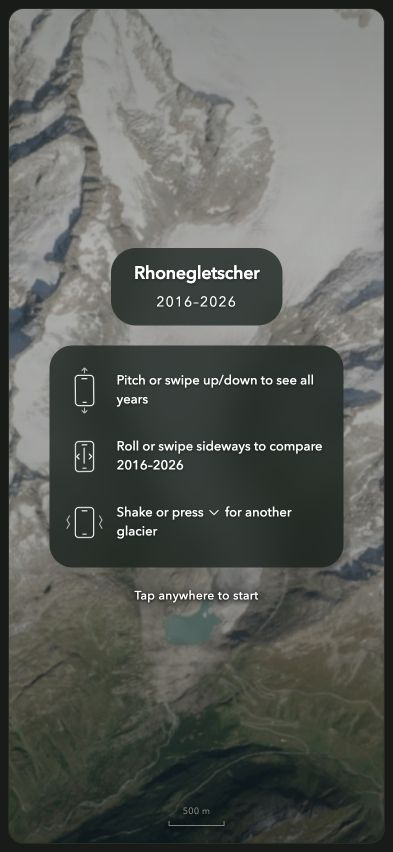
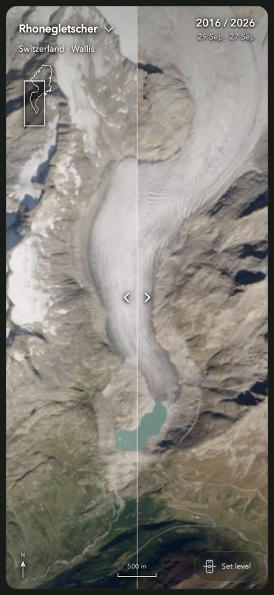

# Tilt

Glacier change, in your hands. Eleven years of satellite imagery, controlled by how you move your phone.

**[Open Tilt →](https://braakhekke.github.io/tilt/)**

  
  

## Try it

Tap anywhere to start and allow motion access.

| Gesture | What happens |
| --- | --- |
| **Pitch** or swipe up/down | Explore 2016–2026, starting at 2021. |
| **Roll** or swipe sideways | Open the 2016/2026 comparison at the midpoint. |
| **Pitch forward** in comparison | Return to 2021, centered at your current phone angle. |
| **Shake** or tap the title chevron | Switch glacier. |
| **Pinch** / two-finger drag | Zoom / pan. |
| **Set level** | Make your current phone position the center again. |

Swipes and the glacier picker also work without motion access.

## The imagery

**Grosser Aletschgletscher** and **Rhonegletscher**, Switzerland · Wallis.

Eleven Sentinel-2 Level-1C scenes per glacier, exported through [Tongues from Space](https://tonguesfromspace.org/) using CDSE imagery and the Copernicus Browser optimized true-colour recipe. Every year uses the same crop; acquisition dates appear below the year.

Modified Copernicus Sentinel data · CDSE · Tongues from Space / Jochem Braakhekke. Locator outlines: GLAMOS (2023). Scale and overview footprints are approximate.

## Run it

Static HTML and local images; no build step, API keys or runtime services. Serve the repository with any static web server. GitHub Pages publishes the root of `main`.

[Scene metadata](imagery.json) · [Rhône metadata](rhone-imagery.json) · [Scale calibration](scale-calibration.json) · [Outline provenance](locator-provenance.json)
